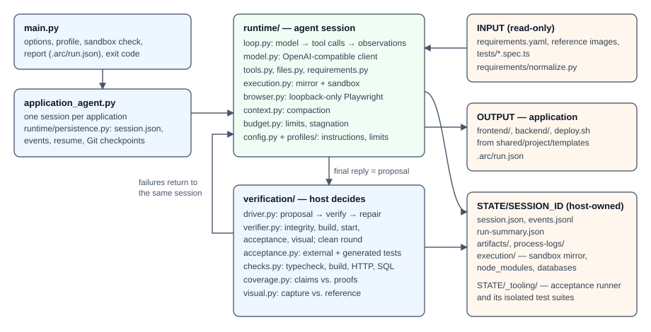

# Application Agent

Builds a React + Express + SQLite application from a requirement tree
(`requirements.yaml`, reference images, optional tests) with **one development-agent
session per application**. The agent reads the requirements, explores and edits every
layer, runs commands in a sandbox and checks the result in a browser. When it says it
is done, the **host verifies the application independently** and returns failures to
the same session for repair. Only a host-verified application counts as a success.

The conversation loop, tools, sessions and budgets are this project's own code,
inspired by LingCore without importing or shipping it. The former 13-pass compiler and
its intermediate representations were removed; the
[migration plan](PLAN_MIGRATION_AGENT_LINGCORE.md) records each step and its validation,
and `benchmarks/baseline/compiler.zip` keeps the frozen pipeline for comparisons.

No Arcbench score is claimed for this engine yet: see [Evaluation](#evaluation).

## Environment

Install [Python 3.11+](https://www.python.org/downloads/), [Node.js 22.12+ with npm](https://nodejs.org/en/download),
[uv](https://docs.astral.sh/uv/getting-started/installation/) and Git, then from the repository root:

```bash
uv sync
uv run playwright install chromium     # Linux: add --with-deps to install system libraries
```

Copy `.env.example` to `.env` and set `OPENAI_API_KEY`, `OPENAI_BASE_URL` and `MODEL`.
The endpoint must support native function calls (`uv run main.py --probe` checks it with
two paid requests). Never put keys in a profile.

Commands written by the agent never run directly on your machine by default:

| Platform | Sandbox | Preparation |
| --- | --- | --- |
| Windows | Docker | Docker Desktop running, `docker pull node:22-bookworm` |
| Linux | Bubblewrap | `bwrap` installed and user namespaces allowed |
| Disposable machine or CI container | none (`--sandbox host`) | Node.js and npm on the host |

There is no automatic fallback: if the sandbox is unavailable the run stops before any
model request with `environment_error`. `--sandbox host` is an explicit choice for a
machine that is itself disposable; commands then run in the session's mirror directory
with a clean environment but **without isolation**.

The default `arcbench-app` profile uses `host` because the ArcBench runner does not
allow this project to install `bwrap` or change the launch command. This assumes the
ArcBench runner itself is already isolated. The dedicated `linux.yaml` profile still
requires Bubblewrap.

The default profile keeps visual comparison in `report` mode and uses the optional
vision-model fallback to explain visual differences when available.

### ArcBench runner image with Bubblewrap

The ArcBench runner image must contain `bwrap`; installing it in the application
workspace is too late because the sandbox check runs before the agent starts. Build the
provided image and configure ArcBench to use the resulting image:

```bash
docker build -f Dockerfile.arcbench \
  -t arcbench-runner-bwrap:latest .
```

If the private registry image is not available in the build environment, set the base
image explicitly to the runner image supplied by ArcBench:

```bash
docker build -f Dockerfile.arcbench \
  --build-arg ARCBENCH_RUNNER_IMAGE=regt3h8hc.arc-bench.com/arcbench-runner:latest \
  -t arcbench-runner-bwrap:latest .
```

Select `arcbench-runner-bwrap:latest` as the ArcBench runner image, then verify inside
the runner:

```bash
which bwrap
bwrap --version
uv run main.py --check-environment --sandbox bubblewrap
```

The runner must also permit unprivileged user namespaces. If the image can be changed
but the ArcBench runtime cannot, installing the package alone will not be sufficient.

Check the setup without any model call:

```bash
uv run main.py --check-config
uv run main.py --check-environment
```

## Run

```bash
uv run main.py input --output-dir outputs/demo
```

The input directory contains `requirements.yaml`, its referenced images and optionally
`tests/*.spec.ts` (Playwright tests used for acceptance). Input and output must be
disjoint directories.

| Option | Meaning |
| --- | --- |
| `--port 3000` | Default port of the generated application |
| `--profile FILE` | Generation profile (default `profiles/arcbench-app/config.yaml`) |
| `--max-requests N`, `--max-seconds N` | Override the run-wide limits of the profile |
| `--sandbox auto\|docker\|bubblewrap\|host` | Execution backend |
| `--resume SESSION_ID` | Continue a saved session (same input and profile) |
| `--state-dir DIR` | Where session state is kept (default `.agent-state` beside the output) |
| `--model-log` | Print every session event while running |

The last line of standard output is a JSON report, also saved as
`OUTPUT/.arc/run.json`. Exit codes: `0` application accepted, `130` interrupted, `1` any
other outcome, `2` invalid command line or configuration.

| Outcome | Meaning |
| --- | --- |
| `accepted` | Verified by the host from a clean delivery state |
| `failed` | Functional failure remains, repairs stagnated, or protected files were modified |
| `provider_error` | The model provider failed and the application is not accepted |
| `environment_error` | Sandbox, Node or browser unavailable; not a verdict on the application |
| `budget_exceeded` | A run-wide limit was reached before acceptance |
| `verification_missing` | Nothing independent could judge the behavior |
| `interrupted` | Stopped by the user; completed writes are retained |

A truncated model reply is continued, never counted as done.

## How a run works

```text
main.py INPUT --output-dir OUTPUT
   prepare: load requirements locally, create the application skeleton if missing
   one agent session ──► read / search / plan / edit / run / observe ◄── observations
        │ final reply = completion proposal
        ▼
   host verification: integrity → dependencies → build → start → acceptance tests → visual
        ├─ failed, repairable ──► compact feedback into the same session
        ├─ candidate            ──► confirmed from a clean delivery state
        └─ accepted / explicit non-success outcome
```

- **Requirements** are loaded without a model call into a lossless catalogue. Small
  documents are given whole; large ones are read by id with their parent constraints.
  Reference images are inspected on demand.
- **Tools**: file read/edit/patch/search, requirement and coverage lookup, todo list and
  notes, sandboxed commands, dependency installation, reusable services, targeted checks
  (`verify_application`: typecheck, build, backend tests), `http_request`,
  `database_query`, a loopback-only browser and read-only Git.
- **Parallel sub-agents**: `delegate_tasks` writes up to four independent parts at the same time,
  each in its own session that may write only its own paths and runs no command; the lead
  agent writes the shared contract first, then integrates and verifies.
- **Fewer round trips**: every request resends the conversation, so the instructions ask
  for grouped work. `read_files` and `write_files` handle several files per call,
  `verify_application` installs changed dependencies itself and `kind: all` chains
  typecheck, build and backend tests, and `process_start` with `probe_path` returns the
  first HTTP response. Consecutive read-only calls of one response run concurrently;
  calls with an effect keep the order the model gave.
- **Acceptance** is isolated from the workspace. It uses the supplied external tests
  unchanged and generates Playwright tests only for scenarios they do not cover, from the
  original requirement. The agent receives symptoms and requirement ids, never test source.
- **Coverage** keeps the agent's declarations apart from host verification and marks every
  proof stale once sources change. Visual conformance is judged separately from behavior.
- **Lighter context**: obsolete observations (a read of a file rewritten or read again
  later, a repeated check, command or search, older page snapshots) are replaced by one
  line once `loop.prune_min_bytes` can be reclaimed at once, and stay retrievable as
  artifacts. Build, compiler and package-manager logs are reduced to their error lines.
  The report gives input, output and provider-cached tokens.
- **Budget** is one for the whole run: wall time with a reserve for the final verification,
  model requests by category, tool calls and reported tokens. Identical calls with
  identical results are redirected, then stopped.
- **Verification cost**: fast stages first, previously failing tests first, dependencies
  and builds reused only while every input is unchanged; success always comes from a
  clean round.

## State, resume and checkpoints

Each run has its own directory `STATE/SESSION_ID/` with `session.json` (conversation,
counters, fingerprints; atomic writes with a recoverable previous version),
`events.jsonl`, `run-summary.json`, artifacts, process logs and the execution mirror.
Known secret values and credential-shaped strings are masked before writing.

`--resume SESSION_ID` continues the conversation with the same budget counters. It is
refused when the input files or the profile's instructions changed. Resuming restores
**no file**: the workspace is whatever the previous run left, including the effects of
an interrupted command, and the agent is told to inspect it. File states are recorded
separately as Git commits in the output directory after each verification
(`checkpoints` in the report); restore one with ordinary Git commands.

Two runs never share working state: a new run starts a new session, workspace mirror
and databases.

## Profiles

`profiles/arcbench-app/config.yaml` defines the model, tools, loop limits, `budget:`,
`acceptance:` and `execution:`. A profile may `extends:` another file of its directory
and state only its differences (`linux.yaml`, `windows.yaml`, the `variant-*.yaml`
experiments). `role.md` and `workflow.md` are the stable instructions.

Setting priority: process environment, then the settings file (`--env-file`, default
`.env` beside `main.py`), then the profile. `MODEL`, `OPENAI_BASE_URL`, `OPENAI_API_KEY`,
`MODEL_REASONING`, `MAX_OUTPUT_TOKENS` and the `VISUAL_*` equivalents are supported.
`image_mode: fallback` sends images to the visual model; `native` attaches them to the
main conversation.

The limits shipped in the profile (250 requests, 5 400 s including 900 s reserved,
12 M reported tokens) are initial values derived from the frozen baseline runs, not
calibrated on runs of this engine.

## Code map



```text
main.py                         public CLI, report and exit codes
profiles/arcbench-app/          profiles, instructions, optional skills
infrastructure/
  application_agent.py          one persistent session per application
  runtime/                      loop, model client, tools, sandbox, browser, context,
                                budget, persistence, profile loader
  verification/                 targeted checks, acceptance suite, host verifier,
                                coverage registry, visual comparison, repair driver
  requirements/                 deterministic normalization of the requirement tree
  shared/project/               application skeleton and templates
scripts/package.py              submission archive
scripts/evaluate.py             paired comparison runs and reports
benchmarks/                     frozen baseline, cases, protocol, variants, criteria
```

## Tests

```bash
uv run --with pytest python -m pytest tests
```

The suite is offline (scripted model, simulated runtime). Three integration tests are
opt-in: `AGENTASE_TEST_SANDBOX=docker|bubblewrap` (real isolation),
`AGENTASE_TEST_ACCEPTANCE=1` (real Playwright acceptance; installs `@playwright/test`
from npm on first use).

## Packaging

```bash
uv run python scripts/package.py --arcbench --output outputs/agent-arcbench.zip
```

The archive holds the engine, profiles, templates, tests and dependency manifests. It
refuses numbered pipeline scripts, any LingCore import and any file containing an API
key from `.env`; the shipped `.env` keeps model settings with an empty key, which the
runner must supply through `OPENAI_API_KEY`.

## Evaluation

`scripts/evaluate.py` runs paired comparisons (same cases, alternating order, new
workspace per run) and records every run, including failures and timeouts, as described
in [benchmarks/PROTOCOL.md](benchmarks/PROTOCOL.md):

```bash
uv run python scripts/evaluate.py plan --variants benchmarks/variants.json --cases input --repeats 2
uv run python scripts/evaluate.py run  --variants benchmarks/variants.json --cases input --repeats 2 \
    --records outputs/eval/runs.jsonl --work outputs/eval --yes        # paid model requests
uv run python scripts/evaluate.py external --records outputs/eval/runs.jsonl --run-id ID --passed true --score 0.8
uv run python scripts/evaluate.py report --records outputs/eval/runs.jsonl \
    --criteria benchmarks/criteria.json --baseline baseline --candidate agent
```

To see where one run spent its requests, tokens and time (model wait, each tool, each
verification stage, verification rounds), or to compare several runs:

```bash
uv run python scripts/analyze_run.py outputs/demo
uv run python scripts/analyze_run.py outputs/run-a/.arc/run.json outputs/run-b/.arc/run.json
```

`main.py` prints the same facts on one `Run breakdown:` line at the end of a run.
`--cases benchmarks/cases input` selects the seven local cases; two repeats per case is
the default and the minimum the report accepts.

A local acceptance is not an external success: `external_passed` stays empty until an
Arcbench result is attached. `benchmarks/criteria.json` holds the maximum acceptable
quality loss and the minimum useful gain; confirm it **before** the first run. Until
confirmed criteria and enough externally evaluated pairs exist, the report answers
`insufficient_evidence`.

Two optional mechanisms are available as ablation variants and are off by default until
measured: on-demand practice guides (`variant-skills.yaml`) and symbol lookup
(`variant-symbols.yaml`).

## Known limits

- Acceptance tests and the Playwright runner execute on the host (Node required), outside
  the sandbox, with a cleaned environment; the application stays sandboxed.
- The clean verification round keeps `node_modules` unless `acceptance.clean_install: true`.
- Without an intermediate representation, any source change invalidates every proof.
- The deterministic visual threshold is an uncalibrated heuristic.
- A passing test is known to have executed, not to contain meaningful assertions.
- Streaming and explicit prompt-cache keys are not implemented.
